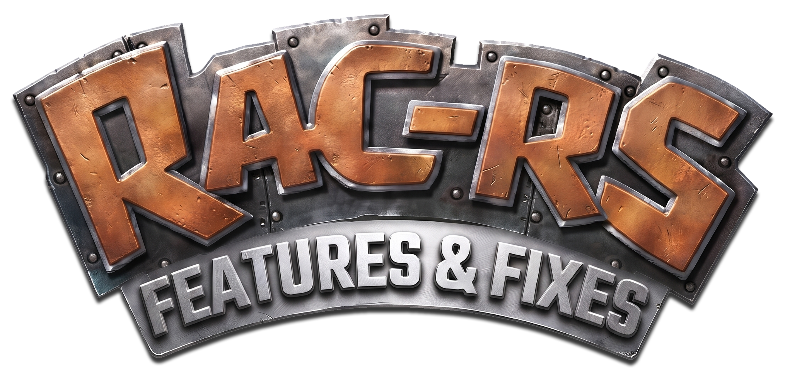

<p align="center">
  
</p>

<p align="center">
  <strong>A features and fixes fork of rac-rs.</strong><br>
  Ratchet &amp; Clank (PlayStation 2, 2002) on Windows and Linux, from your own disc.
</p>

<p align="center">
  <a href="LICENSE"></a>
  <a href="VERSION"></a>
  <a href="https://github.com/AsobiCodes/rac-rs"></a>
  <a href="https://ko-fi.com/desynkro"></a>
</p>

<p align="center">
  A fork of <a href="https://github.com/AsobiCodes/rac-rs">rac-rs</a> by
  <a href="https://github.com/AsobiCodes">AsobiCodes</a>, maintained by
  <a href="https://github.com/DeSynkro">DeSynkro</a>.
</p>

> **No game data is included.** This repository contains no game code, graphics, sound, text or other game files.
> The setup reads your own copy of the disc and creates everything it needs on your PC. You need to own the game.

## What this fork is

This repository used to be **rac-rs-linux**. In v0.4.1, AsobiCodes merged the
Linux build into upstream, so a dedicated Linux fork is no longer needed. I have
repurposed it as a rac-rs+ of sorts, a place to fix bugs, test quality-of-life
and user-friendly features, and help the project move forward in my own way, in
the hope that Asobi merges what fits.

Every feature and fix is kept in its own commit with a detailed message,
so it can be reviewed and merged on its own. That is the point of the branch.

- **Active branch:** `features-0.4.1`, based on upstream `v0.4.1`.
- **The old Linux release:** branch `linux-0.4.0`, tag `rac-rs-linux-0.4.0`, kept
  for reference. Its launcher is not part of this branch.
- **Upstream:** [AsobiCodes/rac-rs](https://github.com/AsobiCodes/rac-rs).

The Linux support, gamepads and prompts this fork began with are in upstream
v0.4.1 now. What remains here is the next round of fixes and features.

## What this fork adds

On top of upstream v0.4.1:

- **Saves show when you saved.** The console has no clock, so the game used to
  write a blank date. It now takes your PC's local time, on the memory card too,
  and the Load Game screen shows it as month/day/year.
- **Skip the boot logos.** Enter, Esc, Space or the controller's Start ends the
  Insomniac intro while it plays. The Skip intro row still turns the logos off
  before they start.
- **Camera Reversed, mouse untouched.** The game's Left/Right and Up/Down
  Reversed options now turn the right stick and the keyboard camera keys only.
  The mouse always looks the way it moves.
- **Button glyphs for your pad.** PlayStation shapes, Xbox pictures, or the
  Nintendo Switch's pictures with the four face buttons the other way round.
  Xbox is the default. An option to switch to your perfect glyph can be found
  in the Options > Graphics menu.
- **The title's Graphics page matches the pause page.** Options > Graphics on
  the title has the same five sections and rows as Pause > Options > Graphics,
  Preset included.

## Status

- The whole game is playable from power-on to the end credits, including
  New Game+.
- Gameplay follows the original PS2 game one to one. On top of that, the PC
  version has widescreen, keyboard and mouse controls, gamepad support, and an
  optional modern camera (mouse look and strafing).
- Optional modern graphics on the Graphics page (Pause > Options > Graphics):
  enhanced lighting with volumetric fog, 3D clouds and shining stars, global
  illumination, ambient occlusion, dynamic shadows, clear reflective water with
  waves and tides, vegetation, enhanced smoke, fire and explosions, sun rays,
  frame smoothing and a sharp HUD, each with quality levels, plus a Graphics
  Preset row (Low / Medium / High / Custom). The Classic settings keep the
  original PS2 look.
- Two renderers on Windows: Vulkan (the default) and DirectX 12 (Options >
  Graphics > Screen > Renderer). ReShade works with both. On Linux the game uses
  Vulkan only, and the Renderer row is not shown.
- **RAC-RS Launcher** (since v0.4): a separate app to play, change every option,
  manage texture packs and mods, keep several game versions side by side, and
  update with a backup first. See [Launcher](#launcher).
- **Mods** (since v0.4): script mods through the bundled OmniLoader mod loader.
  **Arsenal Mastery** comes preinstalled and switched off. See
  [Mods and texture packs](#mods-and-texture-packs).
- **PCSX2 texture packs** (since v0.4): packs made for PCSX2 work as they are.
- Plays from the PAL / Europe disc and, since v0.2, from the USA disc.
- Windows 10 and 11, and since v0.4.1 Linux (x86-64). See [Linux](#linux).
- This fork is tested on CachyOS with KDE Plasma and an AMD graphics card.
  Please report what you find on other systems.
- Known issues are listed under [Known issues](#known-issues) below.

## How it works

The game runs on its own original code. When you run setup, it translates the
PS2 code from your disc into native Rust ("static recompilation"), and that code
runs on a PS2 CPU core written in Rust. Because the game logic is the original
code, gameplay behaves exactly like the PS2 version.

Everything around the game code is native PC code written for this port:
graphics, sound, movies, input, saving, and the PC features. Where a fix, a PC
feature or speed needs it, an original function is rewritten in readable Rust.
Changes are tested against the original: test runs play the same frames on both
versions and compare the game's memory.

## Goal

A faithful, fully playable PC version of Ratchet & Clank that you build from
your own disc, with PC improvements on top. The game logic stays the original
code. Rewriting the whole game from scratch is not a goal of this project.

## What you need

- **The game disc:** Ratchet & Clank, **PAL / Europe v1.00** (serial SCES-50916)
  or **USA v1.00** (serial SCUS-97199). Make an `.iso` image of **your own**
  disc. Other versions (Japan, Platinum and Greatest Hits re-releases) are not
  supported yet. Setup checks the image.
- **About the USA version:** it should play the same as the PAL version (at 60
  frames per second, like the original US game), but it has had less testing so
  far. If something looks or behaves differently from the PAL version, please
  open an issue.
- **Windows 10 or 11, 64-bit**, with about **5 GB of free disk space** (the
  finished install takes about 3.5 GB) and an internet connection for the first
  setup.
- **A 64-bit Linux** with glibc 2.28 or newer, about **7 GB of free space** on a
  Linux drive, and a Vulkan driver. The [Linux](#linux) section lists the
  packages and the details.

That's all. Setup downloads anything else it needs into its own folder.

## Quick Start

### Windows

This branch is built from source. Download or clone this repository (the
`features-0.4.1` branch) and unzip it anywhere. The upstream release ZIP does
not include this fork's changes.

1. Double-click **Setup.cmd**. A window opens (no black console window).
2. Click **Browse** and pick your `.iso` file. The window checks it and shows a
   green **Disc OK**. Two boxes below choose whether to also install the
   **RAC-RS Launcher** and whether to **add the game to Steam** (close Steam
   first). Then click **Install**.
3. Wait. The window shows the steps and a progress bar (about 15 minutes; you
   can keep using your PC). When it says **Ready to play**, click **Play**.

Next time, double-click the **Ratchet & Clank (rac-rs)** shortcut on your
desktop (it opens the launcher if you installed it, otherwise the game), or open
Setup.cmd and click **Play**. The same window also has **Repair / rebuild** if
something breaks. If anything goes wrong the window says which step failed and
has a **Copy details** button. For troubleshooting, `Setup.cmd -Console` runs
setup in a console window instead.

### Linux

This fork is built from source. Put your disc image in the `rom` folder, or give
its path:

```sh
sh setup.sh                          # finds the .iso in rom/, finds or downloads the tools, checks the disc, generates the game code, builds
sh setup.sh --iso "/path/to/disc.iso"
./play.sh                            # starts the game
```

The first build takes 10 to 30 minutes. `setup.sh` writes only inside the game
folder. It downloads its own private copy of Rust, Python and a C linker into
`toolchain`, so you do not need a compiler, development packages or `sudo`.
With `--system-toolchain` it uses your own Rust, Python and C compiler instead;
it is remembered until you pass `--pinned-toolchain`. `sudo docker compose up`
is a third way: it builds the game in a Debian 12 container. Run setup again
after an update.

**Do not share or upload the generated files or the built game.** They contain
code generated from the game disc. Everything setup creates stays inside this
folder.

## Linux

Since v0.4.1, rac-rs also runs on Linux (x86-64). It is the same game code as
on Windows, built from your own disc, and a recorded fight gives identical game
memory on both. The Linux port was set up by
**[DeSynkro](https://github.com/DeSynkro)** ([pull request
#38](https://github.com/AsobiCodes/rac-rs/pull/38)). Upstream tested it on
Ubuntu 24.04 and Arch Linux (under WSL, with software Vulkan). This fork is
tested on CachyOS with KDE Plasma and real AMD Vulkan drivers.

Like on Windows, you do not install any programming tools. `setup.sh` downloads
its own private copy of Rust 1.99, Python 3.14 and a C linker (zig) into the
game folder (`toolchain`, about 250 MB to download and 1 GB on disk), plus the
Rust libraries that `cargo` fetches from crates.io (about 200 MB). There is no
compiler, `pkg-config`, development package or `sudo` involved. You need:

- A 64-bit Intel/AMD Linux with glibc 2.28 or newer (every mainstream
  distribution since 2019, SteamOS 3 included), about 7 GB of free space on a
  Linux drive (ext4, btrfs; not an SD card formatted as FAT or exFAT, which
  cannot run programs or make links; `setup.sh` checks this) and an internet
  connection for the first setup.
- A Vulkan-capable graphics driver (Mesa for AMD/Intel, the NVIDIA driver for
  NVIDIA). On Linux the game uses Vulkan only; there is no Renderer row in the
  Options menu.
- Ordinary run-time libraries, which any desktop install already has (a minimal
  or server install may not): ALSA (sound), udev (gamepads), the Vulkan loader,
  the keyboard library xkbcommon and the X11 window libraries (Xlib, Xcursor,
  Xi; on a pure Wayland desktop `libwayland-client` instead). `setup.sh` looks
  for them first and prints the install line for your distribution if one is
  missing. Without one of the window libraries the game stops at start with
  "Failed to load one of xlib's shared libraries". The packages:
  - Debian / Ubuntu: `sudo apt install libasound2t64 libudev1 libvulkan1 libxkbcommon-x11-0 libx11-6 libx11-xcb1 libxcursor1 libxi6` (`libasound2` instead of `libasound2t64` on Ubuntu 22.04, Debian 12 and older)
  - Arch: `sudo pacman -S alsa-lib systemd-libs vulkan-icd-loader libxkbcommon-x11 libx11 libxcursor libxi`
  - Fedora: `sudo dnf install alsa-lib systemd-libs vulkan-loader libxkbcommon-x11 libX11 libX11-xcb libXcursor libXi`
  - SteamOS has all of them.
- Your Ratchet & Clank disc image: PAL/Europe v1.00 (SCES-50916) or USA
  v1.00 (SCUS-97199). Put it in the `rom` folder, or give its path.

Gamepads: Xbox-style controllers, DualShock 4 and DualSense are read through
the kernel's evdev interface (the SDL controller database that ships inside the
`gilrs` library decides which button is which). A controller plugged in while
the game runs is picked up. The first controller found is used.

Differences from Windows, for now:

- The Linux build has no profile-guided speed boost (PGO), so it can run slower
  than the Windows build on the same machine.
- Mods written as scripts (the OmniLoader mods, for example Arsenal Mastery)
  need the OmniLoader library, which only exists for Windows so far. Without it
  the game hides those mod rows; texture packs work as before.
- The update window and the Windows-only options (Renderer, RivaTuner, ReShade)
  do not exist. To update this fork, pull the branch and run `sh setup.sh` again
  (it notices what changed and rebuilds only that).
- The game writes `player/log.txt` (the run log when started from a menu or file
  manager) and `player/crash.log` (panics) next to the saves.

## Launcher

The **RAC-RS Launcher**
([AsobiCodes/rac-rs-launcher](https://github.com/AsobiCodes/rac-rs-launcher))
is an optional app next to the game. Setup offers to install it; you can also
download it from its own release page. From the launcher you can:

- start the game, and change every option (graphics, camera, controls, Skip
  intro) before you play,
- add, import and switch PCSX2 texture packs, and turn mods on or off with their
  own settings,
- keep several game versions side by side and use profiles,
- update the game: it backs up your current version first.

The game works the same without the launcher; everything it changes can also be
set in the game's own menus. The launcher is upstream's, and its updater follows
upstream releases, not this branch. This branch does not include the old fork
launcher; that one lives with the `linux-0.4.0` release.

## Mods and texture packs

- **Script mods** run through **OmniLoader**, this project's own mod loader,
  which comes with the game (`bundled\omniloader.dll` on Windows). Turn mods on
  or off in the launcher's Mods page or on the title screen under Options >
  Mods. With no mod switched on, the game plays exactly as before.
- **The mod format comes from OpenRAC.** OmniLoader is this project's own code,
  written from the public, MIT-licensed mod SDK of
  [OpenRAC](https://github.com/OpenRAC/OpenRAC) (another Ratchet & Clank PC
  project). It follows OpenRAC's script-mod format and Luau API, so a mod folder
  with OpenRAC's `openrac-mod.json` is read too. No code of OpenRAC's game port
  is used. Credit and the SDK licence are in [NOTICE.md](NOTICE.md).
- **Arsenal Mastery** is preinstalled and switched off: a fan-remaster style mod
  where weapons level up like in Ratchet & Clank 3, Nanotech levels raise
  Ratchet's health and enemies are rebalanced to match. Switch it on in the
  launcher when you want it.
- **PCSX2 texture packs:** add a pack made for PCSX2 (a folder or a .zip) in the
  launcher, or import it from your PCSX2 texture folder. Packs cover world
  textures, water, sky, chrome and glass, the ship, particles, grass, and the
  HUD and menus. A pack made for the other disc region mostly works too. Turn
  packs on or off on the title screen under Options > Mods; while one is on,
  Pause > Options > Mods has the switches in game too.

## Making mods

- **Script mods** (Luau, run by OmniLoader): [docs/MODDING.md](docs/MODDING.md)
  is a step-by-step guide with a 5-minute first mod, hooks, fields, drawing and
  per-save data. The preinstalled
  [Arsenal Mastery](bundled/mods/arsenal-mastery) is a full worked example.
- **Reference**: [docs/MODDING_REFERENCE.md](docs/MODDING_REFERENCE.md) lists
  every hook id, game function and field.
- **Texture packs** (PCSX2 format): [docs/TEXTURE_PACKS.md](docs/TEXTURE_PACKS.md)
  shows how players add and switch packs and how to make one.

## Updating

Upstream releases check online for a newer version when the game starts and can
update themselves, keeping saves, settings and the downloaded tools. This fork
is a branch, so update it from git:

```sh
git pull
sh setup.sh
```

Your saves, your disc setting and the downloaded Rust libraries are kept, and
only the parts that changed are rebuilt. What changed in each upstream version
is in [CHANGELOG.md](CHANGELOG.md).

## Controls

The game's own button prompts show the keyboard and mouse keys, the controller's
buttons, or the other, whichever you used last. You can change the camera style,
the language and every button in the game's Options menu (Pause > Options >
Controls for the buttons; Camera speed and Mouse speed are separate rows).

Controllers work too: Xbox-style controllers (XInput) and PlayStation controllers
(PS4 DualShock 4 and PS5 DualSense, over USB or Bluetooth), also when you switch
one on or plug it in after the game has started. With the modern camera on, hold
R2 to strafe.

A controller's buttons are shown the way your pad labels them. Pick the style on
the title screen (Options > Graphics > System) or in the game (Pause > Options >
Graphics > System > Button glyphs):

| | PlayStation | Xbox | Switch |
|---|---|---|---|
| The bottom button | Cross | A | B |
| The right button | Circle | B | A |
| The top button | Triangle | Y | X |
| The left button | Square | X | Y |
| The shoulders | L1, R1 | LB, RB | LB, RB |
| The triggers | L2, R2 | LT, RT | LT, RT |
| The sticks | L3, R3 | L3, R3 | L3, R3 |

PlayStation shows the shapes the game came with. Xbox and Switch show the
buttons as pictures, the green A disc and the rest, with the four face buttons
the other way round for the Switch, whose bottom button is B and whose right one
is A. Xbox is the default.

The style is for a controller: with the keyboard the prompts name the buttons by
key, as they always have. A button you have rebound is shown as the button it is
really played with. If you put the Circle on the RT, the prompts say RT and show
the RT's picture, and the RT is what presses it.

| | Classic | Static | Smooth |
|---|---|---|---|
| Camera | the original PS2 follow camera | mouse look and strafing | mouse look, softer |
| R2 | does nothing | aims | aims |
| L2 | does nothing | nothing | nothing |

With the camera on, hold R2 to strafe. Smooth is the default: it follows softly,
recentres lazily while you run, looks down at drops and pulls in at walls. The
camera speed, the mouse speed and the lock-on circle are on the same page. The
camera's Reversed options turn the right stick and the Q/E and Z/X keys; the
mouse keeps its own direction.

The intro can be skipped while it plays (Enter, Esc, Space or the controller's
Start) and turned off for good with Options > Graphics > System > Skip intro, on
the title screen or in the game.

The title screen's Graphics page takes Cross / A to step a row's value and the
Up / Down arrow keys to move between rows. The pause menu's Graphics page also
takes Left / Right on its Page row and on the rows.

## Known issues

- The port's own menus (title, pause, options, mods) are worked with the
  keyboard, the mouse or the left stick. The controller's D-pad does not move
  them yet. The game's own pages still take the D-pad.
- Changing Button glyphs in the pause menu, or a controller binding, can leave
  the menu pictures on the old style until the next level load. The choice is
  saved and applies fully then. The game's own in-world prompts also follow on
  that next load when the GPU capture is on.
- Script and native mods need an OmniLoader library built for Linux. Upstream
  only publishes the Windows DLL, so the Mods page hides those rows and plays
  exactly as before. Arsenal Mastery stays in the mods folder, switched off,
  until a Linux loader exists.
- The faint afterimage trail behind Ratchet during Thruster-Pack flight is not
  drawn yet.
- Some glass surfaces can flicker.
- On AMD and Intel graphics, HUD Sharp only sharpens the title screen and main
  menu for now. In game, the on-screen text, icons, menus and shop keep the
  Original look.
- DirectX 12, ReShade and RivaTuner are Windows-only and are not part of the
  Linux build. See the [Linux](#linux) section.

## Reporting a problem

If the game freezes, crashes or looks wrong, please [open an
issue](https://github.com/DeSynkro/rac-rs-linux/issues) and attach
`player/log.txt` from your rac-rs folder. The game writes it every time it runs.
It lists your system, processor and graphics card, and what the game did up to
the problem. If the game froze, wait about 15 seconds before you close it: the
log then also says where it got stuck. The previous run is kept as
`player/log.prev.txt`, so if you already restarted the game, attach that file
instead. If you use mods or a texture pack, say which ones, and try once with
them switched off. The log stays on your PC; the game sends it nowhere.

Bugs in this fork's features and fixes belong here. Bugs in upstream rac-rs
belong in the [upstream
issues](https://github.com/AsobiCodes/rac-rs/issues). If you are not sure, open
it here and say which feature it touches.

## For developers

The unit tests read the game data off your disc. They look for it at a fixed
path in the game folder, so make a link to it:

```sh
ln -s "/path/to/Ratchet & Clank.iso" \
      "Ratchet & Clank (Europe) (En,Fr,De,Es,It) (v1.00).iso"
```

Then:

```sh
cargo test --release --manifest-path rac-rs/Cargo.toml -p rac-rs --lib
```

Some tests also want the upstream project's private savestates and game data and
fail or skip without them. The file and function size caps are enforced by the
same suite; `RAC_SIZE_CAPS_WRITE=1` lowers `rac-rs/SIZE_CAPS.txt` after a split.

Each feature and fix in this fork is a separate commit. Keep it that way: one
feature or fix per branch and PR, with tests and the reasoning in the message.

## Contributors

- **[AsobiCodes](https://github.com/AsobiCodes)**: the original rac-rs project,
  and essentially all of it.
- **[DeSynkro](https://github.com/DeSynkro)**: the Linux port ([pull request
  #38](https://github.com/AsobiCodes/rac-rs/pull/38), now in upstream v0.4.1),
  the Linux gamepads and logs, and this fork's fixes and features.

[OpenCode](https://opencode.ai) was used for a portion of the work.

The original project's `NOTICE.md` and `LICENSE` are kept, and the credits for
the third-party work it builds on are in [NOTICE.md](NOTICE.md).

## Legal

This is a fan project for preservation and education. It is **not affiliated
with, endorsed by or sponsored by Sony Interactive Entertainment or Insomniac
Games**. "Ratchet & Clank" is a trademark of Sony Interactive Entertainment LLC.
All game content belongs to its owners. "Xbox" is a trademark of Microsoft.

The repository contains original source code and tools, plus the fork's own
button artwork in [`xboxglyphs/`](xboxglyphs/README.md) and the logo. The button
artwork is the fork's own drawing of the buttons, not Microsoft's. It contains
no copyrighted game data, and it does not tell you how to get the game other
than from a disc you own.

## License

GPL-3.0-or-later, see [LICENSE](LICENSE). The logo and the button artwork in
[`xboxglyphs/`](xboxglyphs/README.md) are the fork's own work under the same
licence. Credits for third-party work are in [NOTICE.md](NOTICE.md).
