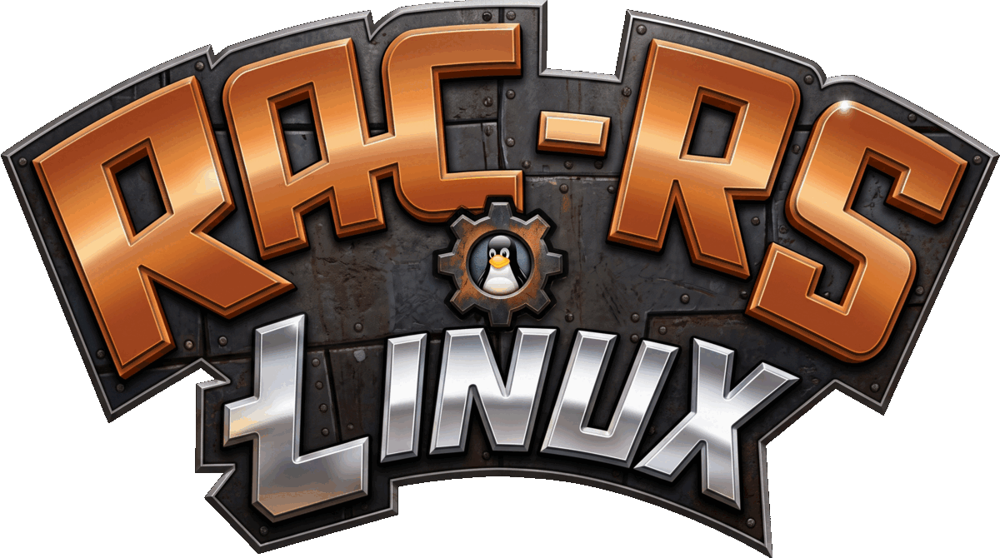

<p align="center"></p>

# rac-rs for Linux

**Fellow Linux users! This one is for you!**

Ratchet & Clank (PlayStation 2, 2002) on Linux, from power-on to the end
credits, built from **your own disc**. The game runs its own original code,
recompiled for your CPU.

This is a fork of **[rac-rs](https://github.com/AsobiCodes/rac-rs)** by
[AsobiCodes](https://github.com/AsobiCodes), a remarkable piece of work that
made the whole game playable on a PC in the first place. It was built for
Windows. This fork carries it over to Linux, adds what Linux players were
missing, and smooths the edges for anyone who would rather just play the
game than fight their way through a build.

> **No game data is included.** This repository contains no game code,
> graphics, sound, text or other game files. The setup reads your own copy of
> the disc and creates everything it needs on your PC. You need to own the
> game.

## What this fork adds

- **A Docker build.** `sudo docker compose up` builds the game in a container
  that already has everything it needs, so there is nothing to install on your
  machine. It also builds the game against an older C library, so what it
  produces runs on more systems, a Steam Deck included.
- **A native Linux build.** One script, no PowerShell, no Windows toolchain,
  and no 1.2 GB private copy of Rust.
- **Gamepad support.** Xbox-style and PlayStation controllers, over USB or
  Bluetooth, read as evdev devices. Full analog sticks and triggers, and a
  controller plugged in while the game is running is picked up straight away.
- **Prompts that follow your hands.** Mouse and keyboard shows the key names,
  a controller shows the button names, and the game switches between them by
  itself as you use each. A controller's buttons can be shown as the PlayStation
  shapes the game came with, as Xbox pictures, or as the Nintendo Switch's,
  where the four face buttons are the other way round. Pick the one you want in
  the Graphics menu.
- **The controller skips cutscenes.** Start skips, like Spacebar does. The
  Insomniac intro at the start of the game can be skipped too, at last.
- **A crash log.** Panics and errors are written to `player/crash.log`, so you
  can read what went wrong even when the game was started from the application
  menu, where there was no terminal to read.
- **A kinder build.** Drop your disc image in the `rom` folder and run one
  script. It finds the disc, checks it, and builds the game. The build log
  lands in `generated/build.log`, the build is `nice`d so your desktop stays
  usable, and `CARGO_BUILD_JOBS` caps how many cores it takes.

## Not coming back

One thing the 0.2.2 release had is not coming back to the 0.3.0 branch:

- **A third camera style, "Enhanced"** (L2 aims, R2 fires). Every button can
  be rebound in the game's own Options menu now, which does the same thing
  without a camera mode of its own.

## Status

- The whole game is playable from power-on to the end credits, including
  New Game+.
- Gameplay follows the original PS2 game one to one. On top of that, the PC
  version has widescreen, keyboard and mouse controls, gamepad support, and
  three camera styles to choose from.
- Optional modern graphics on the Graphics page (Pause > Options > Graphics):
  enhanced lighting, global illumination, ambient occlusion, dynamic shadows,
  clear reflective water with waves, vegetation, enhanced smoke, fire and
  explosions, sun rays, frame smoothing and a sharp HUD, each with quality
  levels. The Classic settings keep the original PS2 look.
- Every button can be rebound, for the keyboard and for controllers, on the
  Controls page (Pause > Options > Controls).
- Plays from the PAL / Europe disc and, since v0.2, from the USA disc.
- Known issues are listed under [Known issues](#known-issues) below.

## How it works

The game runs on its own original code. When you run the setup, it translates
the PS2 code from your disc into native Rust ("static recompilation"), and
that code runs on a PS2 CPU core written in Rust. Because the game logic is
the original code, gameplay behaves exactly like the PS2 version.

Everything around the game code is native PC code written for this port:
graphics, sound, movies, input, saving, and the PC features. Where a fix or
a PC feature needs it, an original function is rewritten in readable Rust.
Changes are tested against the original: test runs play the same frames on
both versions and compare the game's memory.

## Goal

A faithful, fully playable PC version of Ratchet & Clank that you build from
your own disc, with PC improvements on top. The game logic stays the
original code. Rewriting the whole game from scratch is not a goal of this
project.

## What you need

- **The game disc:** Ratchet & Clank, **PAL / Europe v1.00** (serial
  SCES-50916) or **USA v1.00** (serial SCUS-97199). Make an `.iso` image of
  **your own** disc. Other versions (Japan, Platinum and Greatest Hits
  re-releases) are not supported yet. The setup checks the image.
- **About the USA version:** it plays the same as the PAL version, but it has
  had less testing so far.
- **A 64-bit Linux** with about **5 GB of free disk space** (the finished
  install takes about 3.5 GB).

To play it you also want a Vulkan driver (`vulkan-radeon`, `vulkan-intel` or
the proprietary one) and working sound. A gamepad is optional.

> **Tested on CachyOS with KDE Plasma.** Other distributions and desktop
> environments may need extra packages or a small tweak. If something does
> not work for you, please open an issue and say what you are on.

### Requirements

**Docker and Docker Compose**, and nothing else. The build runs in a
container that already has every tool it needs:

```sh
git clone https://github.com/DeSynkro/rac-rs-linux
cd rac-rs-linux
cp /path/to/your-disc.iso rom/
sudo docker compose up
```

The `sudo` is only there because the container installs packages and writes
to your folder as root. If your user is in the `docker` group, plain
`docker compose up` does exactly the same thing and you can leave the `sudo`
out:

```sh
sudo usermod -aG docker $USER
```

Log out and back in for that to take effect. Being in the `docker` group
means you can do anything root can, so only do it if you are comfortable with
that.

Either way the container hands the files it created back to you when it
finishes, so nothing is left owned by root.

**Or, if you would rather build it yourself natively,** these packages:

| | Arch | Debian / Ubuntu | Fedora |
|---|---|---|---|
| Rust 1.85 or newer | `rust` | `rustup` | `rust` |
| Python 3.8 or newer | `python` | `python3` | `python3` |
| A C compiler, for linking | `gcc` | `build-essential` | `gcc` |
| pkg-config | `pkgconf` | `pkg-config` | `pkgconf-pkg-config` |
| ALSA headers | `alsa-lib` | `libasound2-dev` | `alsa-lib-devel` |
| libudev headers | `systemd-libs` | `libudev-dev` | `systemd-devel` |

```sh
# Arch
sudo pacman -S --needed rust python gcc pkgconf alsa-lib systemd-libs

# Debian / Ubuntu
sudo apt install rustup python3 build-essential pkg-config libasound2-dev libudev-dev

# Fedora
sudo dnf install rust python3 gcc pkgconf-pkg-config alsa-lib-devel systemd-devel
```

Nothing else. The setup script is plain POSIX shell, so it runs under whatever
`/bin/sh` is on your system: bash on Arch and Fedora, dash on Debian and
Ubuntu.

## Setup

The block above is the quick way. These are the details.

1. Download or clone this repository and unpack it anywhere.
2. Put your disc image in the **`rom`** folder. Any name ending in `.iso`
   works. If you have more than one, the setup asks you which to use.
3. Build the game.

   With Docker:

   ```sh
   sudo docker compose up
   ```

   Or without Docker, if you installed the packages above:

   ```sh
   ./setup.sh
   ```

   Either way it checks the disc, generates the game code from it, and builds
   the game. This takes about 8 minutes on a 24-thread CPU, or roughly half an
   hour on a 4-core CPU. You can keep using your computer while it runs.

The build stays on screen when it is done, so you can read the log. Set
`CARGO_BUILD_JOBS=4` to use fewer cores, or pass `--no-pause` to skip the
wait. With Docker, put it in front of the command, as
`sudo CARGO_BUILD_JOBS=4 docker compose up`. A full log is written to
`generated/build.log`.

Next time, run **`./play.sh`**.

The build does the rest by itself:

- **Disc check:** it checks your disc image.
- **Build:** it generates the game code from your disc and builds the game.

To add a "Ratchet & Clank (rac-rs)" entry to your application menu, run
**`./install-desktop-launcher.sh`**. It writes one small file to your home
folder and nothing else, and it works whichever way you built the game.

**Do not share or upload the generated files or the built game.** They contain
code generated from the game disc. Everything the setup creates stays inside
this folder.

## Cleaning up

Docker is only used to build the game. Nothing about running it needs
Docker, so once you have it built you can take away everything the build
left behind.

### Docker

To remove the container, the network and the image the build pulled:

```sh
cd rac-rs-linux
sudo docker compose down --rmi all --volumes
```

Leave out the `sudo` here too if your user is in the `docker` group.

The image is roughly 550 MB to download, and more than that on disk, so it is
worth taking away. Leave out `--rmi all` if you would rather keep it, so the
next build does not have to download it again. Your game stays where it is, in
`build/release/rac-rs`, and keeps working.

If you installed Docker only to build this and want it gone again:

```sh
sudo pacman -Rns docker docker-compose
sudo rm -rf /var/lib/docker
```

The second command deletes everything Docker has on your machine, not just
this project: other images, other containers and other volumes go with it.
Remove it only when you are sure. The `docker` group is left behind as
well; `sudo groupdel docker` takes that away too.

For anything else you have built with Docker, `docker system prune` clears
out stopped containers, unused networks and dangling images, and
`docker system prune -a` also removes the images no container is using.

### The build files

The build also leaves the game code it generated from your disc, and the
compiler's working files, a couple of gigabytes in all. The game does not
need them to run, so **`./clean.sh`** removes them and keeps what it needs:

```sh
./clean.sh
```

It leaves `build/release/rac-rs` and `generated/play.cfg` in place, so the
game still starts, and it does not touch your disc, your saves or the
source code. Run `./setup.sh` again and it generates what it needs, if you
want to build once more.

To do it by hand:

```sh
rm -rf oracle/rec oracle/game
rm -f oracle/src/vu0_prog*.rs oracle/src/skinff_*.rs
rm -f rac-rs/src/gsfull/vu1_prog*.rs rac-rs/src/gsfull/vu1aot_gen.rs
rm -f rac-rs/src/particles/orb_tables.rs
find build -mindepth 1 -maxdepth 1 ! -name release -exec rm -rf {} +
find build/release -mindepth 1 -maxdepth 1 ! -name rac-rs -exec rm -rf {} +
find generated -mindepth 1 -maxdepth 1 ! -name play.cfg -exec rm -rf {} +
```

The last line keeps `generated/play.cfg`, which is where the game looks for
your disc. Without it the game will not start.

## Portability

The game is a normal Linux program. It runs on any 64-bit Linux that has the
same C library, or a newer one, than the system it was built on.

*Worth noting, because it decides where the game will run.
Programs usually link against the C library of the machine it was built on.
Every new version of that library adds its own version of the functions in
it, so a program built on a current desktop asks for functions that an older
system has never heard of. On an older system it then refuses to start,
with a message about a missing library version.*

The Docker build sidesteps that. Its container is Debian 12, whose C library
is older than a current desktop's, so the game it produces asks for less and
runs on more:

| System | C library | The Docker build | A hand build on a current desktop |
|---|---|---|---|
| Ubuntu 22.04 | 2.35 | runs | will not start |
| Debian 12 | 2.36 | runs | will not start |
| Fedora 37 and newer | 2.37 and up | runs | will not start |
| SteamOS 3, the Steam Deck | 2.41 | runs | will not start |
| A current desktop | 2.44 | runs | runs |

A game you build yourself always runs on the machine you built it on. It just
does not travel.

## Playing

Run `./play.sh`. It is a plain shell script, so there is nothing to install to
play. The game starts from your disc, the same way the original did, logos and
all.

If the game stops with an error or a panic, that is written to
**`player/crash.log`**, so you can read it afterwards even if you started the
game from the application menu, where there was no terminal to read.

The whole run is written to **`player/log.txt`** as well: your system and
graphics card, what the game did up to the point it stopped, and, when it
froze, where it got stuck. The run before it is kept as `player/log.prev.txt`.

The game draws the two-dimensional layer, the HUD and the menus, with the
graphics card where it can. On some AMD and Intel cards that made the window
freeze white at the start, so on those cards the layer is drawn by the
processor instead. If your card has never done that, you can have the graphics
card back: write `gpu` in a file named `player/capture.txt` and start the game
again. The file's absence means the safe setting.

## Updating

This fork does not have an automatic updater. Pull the changes instead:

```sh
git pull
./setup.sh
```

Your saves, your disc setting and your downloaded crates are kept, and only
the parts that changed are rebuilt.

## Controls

The game's own button prompts show the keyboard and mouse keys, or the
controller's buttons, whichever you used last. You can change the camera
style, the language and every button in the game's Options menu (Pause >
Options > Controls for the buttons).

Controllers work too: Xbox-style controllers and PlayStation controllers
(PS4 DualShock 4 and PS5 DualSense, over USB or Bluetooth), also when you
switch one on or plug it in after the game has started.

A controller's buttons are shown the way your pad labels them, and you pick
the style in the Graphics menu, on the title screen (Options > Graphics) or in
the game (Pause > Options > Graphics > Screen):

| | PlayStation | Xbox | Switch |
|---|---|---|---|
| The bottom button | Cross | A | B |
| The right button | Circle | B | A |
| The top button | Triangle | Y | X |
| The left button | Square | X | Y |
| The shoulders | L1, R1 | LB, RB | LB, RB |
| The triggers | L2, R2 | LT, RT | LT, RT |
| The sticks | L3, R3 | L3, R3 | L3, R3 |

PlayStation shows the shapes the game came with. Xbox and Switch show the
buttons as pictures, the green A disc and the rest, with the four face buttons
the other way round for the Switch, whose bottom button is B and whose right
one is A. Xbox is the default.

The style is for a controller: with the keyboard the prompts name the buttons
by key, as they always have.

A button you have rebound is shown as the button it is really played with. If
you put the Circle on the RT, the prompts say RT and show the RT's picture, and
the RT is what presses it, in the menus as well as in the game.

| | Classic | Static | Smooth |
|---|---|---|---|
| Camera | the original PS2 follow camera | mouse look and strafing | mouse look, softer |
| R2 | does nothing | aims | aims |
| L2 | does nothing | nothing | nothing |

With the camera on, hold R2 to strafe. Smooth is the default: it follows
softly, recentres lazily while you run, looks down at drops and pulls in at
walls. The camera speed and the lock-on circle are on the same page. The
camera's "Reversed" options turn the right stick; the mouse keeps its own
direction.

## Known issues

- The faint afterimage trail behind Ratchet during Thruster-Pack flight is not
  drawn yet.
- Some glass surfaces can flicker.
- On AMD and Intel graphics, the sharp HUD only sharpens the title screen and
  the main menu for now. In game, the on-screen text, icons, menus and shop
  keep the Original look.

## Reporting a problem

If the game freezes, crashes or looks wrong, please
[open an issue](https://github.com/DeSynkro/rac-rs-linux/issues) and attach
`player/log.txt` from your game folder. The game writes it every time it runs.
If the game froze, wait about fifteen seconds before you close it: the log then
also says where it got stuck. The previous run is kept as `player/log.prev.txt`,
so if you already restarted the game, attach that file instead. The log stays
on your computer; the game sends it nowhere.

## For developers

The unit tests read the game data off your disc. They look for it at a
fixed path in the game folder, so make a link to it:

```sh
ln -s "/path/to/Ratchet & Clank.iso" \
      "Ratchet & Clank (Europe) (En,Fr,De,Es,It) (v1.00).iso"
```

Then `cargo test --release --manifest-path rac-rs/Cargo.toml -p rac-rs --lib`
runs the suite. One test, `retail::memcard`, wants a savestate from the
upstream project's own test data, which is not part of a public checkout, so
it fails here. Everything else passes.

## Credits
**[rac-rs](https://github.com/AsobiCodes/rac-rs)** by
[AsobiCodes](https://github.com/AsobiCodes) is the original project, and
essentially all of it. The Linux port, the gamepad support, the Xbox button
glyphs and the cutscene skip are the work of
**[DeSynkro](https://github.com/DeSynkro)**, who did it for Linux users and
for anyone who would rather just play the game than fight a Windows
installer.

[OpenCode](https://opencode.ai) was used for a portion of the work.

The original project's `NOTICE.md` and `LICENSE` are kept, and the credits for
the third-party work it builds on are in [NOTICE.md](NOTICE.md).

The Xbox button artwork in [`xboxglyphs/`](xboxglyphs/README.md) is part of
that work: the fork's own drawings of the buttons, not Microsoft's.

## Legal

This is a fan project for preservation and education. It is **not affiliated
with, endorsed by or sponsored by Sony Interactive Entertainment or
Insomniac Games**. "Ratchet & Clank" is a trademark of Sony Interactive
Entertainment LLC. All game content belongs to its owners. "Xbox" is a
trademark of Microsoft; the button artwork in `xboxglyphs/` is the fork's own
drawing of the buttons, not Microsoft's.

The repository contains only original source code and tools, apart from the
Xbox button artwork in [`xboxglyphs/`](xboxglyphs/README.md), which is the
fork's own work. It contains no copyrighted game data, and it does not tell
you how to get the game other than from a disc you own.

The Windows installer, the automatic updater and the Windows release of the
game live in the [upstream repository](https://github.com/AsobiCodes/rac-rs),
not here.

## License

GPL-3.0-or-later, see [LICENSE](LICENSE). Credits for third-party work are
in [NOTICE.md](NOTICE.md).
